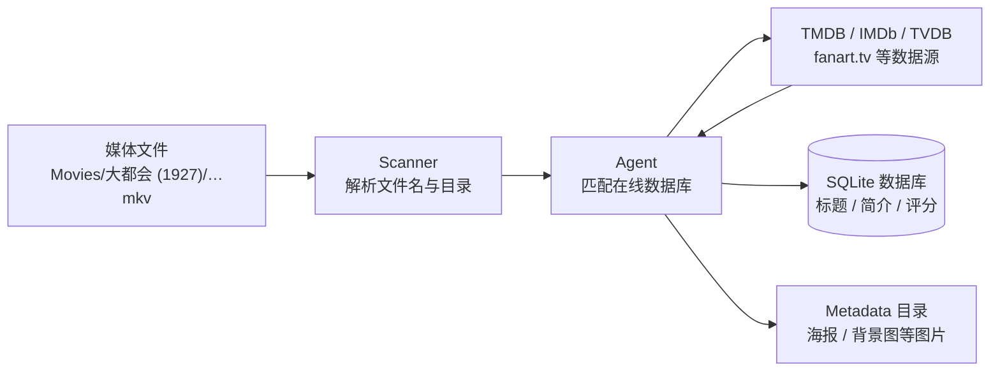
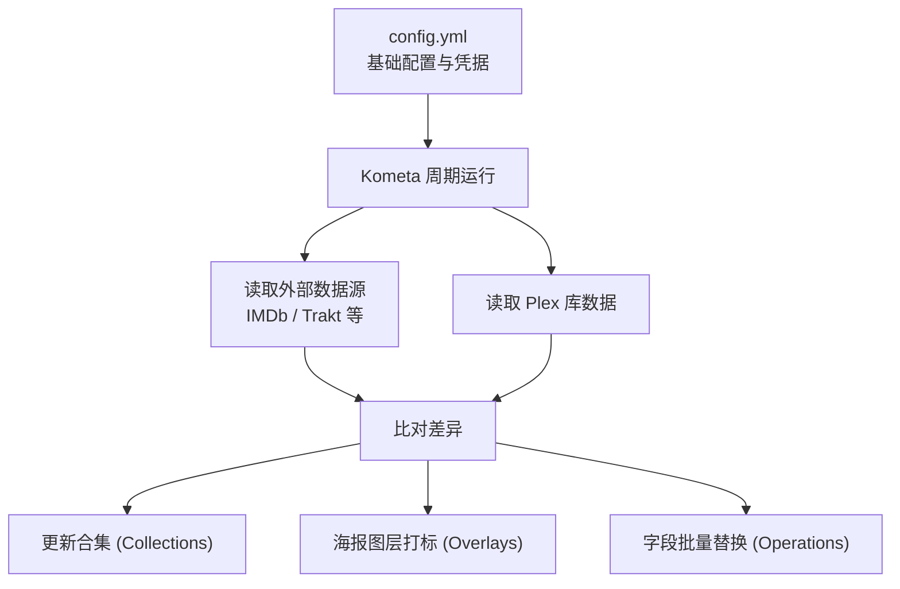

## Plex 元数据的工作原理

一个视频文件从放进媒体库目录，到最终在客户端展示出完整的海报、演员表和简介，Plex 内部主要经历三个步骤：



1. **扫描（Scan）**：扫描器（Scanner）只读取本地的文件路径和文件名，从中提取片名、年份等文字线索。这个阶段不会联网，也不会读取视频内容。因此规范的命名（如 `Metropolis (1927).mkv`）对后续匹配非常关键。
2. **匹配（Match）**：代理（Agent）拿提取到的关键词去在线数据库检索。目前新版 Plex 默认使用内置的 **Plex Movie** 代理，数据整合了 TMDB、IMDb、TVDB 以及社区图库（如 fanart.tv）。早期的插件式代理（如 The Movie Database、Plex Movie Legacy）官方已逐步废弃。
3. **刮削（Scrape）**：匹配命中后，Plex 将远端的详细文本和图片资产同步回本地。

### 核心概念：guid 与 ratingKey

匹配成功后，Plex 会给条目分配两个关键标识：

- **`guid`**：指向外部数据源的全局标识。新版代理使用 Plex 自建的 ID，并在子字段中关联 TMDB/IMDb 编号；旧版代理则直接记录源站地址。
  ```text
  # 旧版代理
  com.plexapp.agents.imdb://tt0017136?lang=en
  com.plexapp.agents.themoviedb://19?lang=en

  # 新版代理（Plex Movie）
  plex://movie/5d7768254de0ee001fcc8f52
    ├── imdb://tt0017136
    ├── tmdb://19
    └── tvdb://…
  ```
- **`ratingKey`**：当前 Plex 服务器数据库中的自增主键（纯数字）。

两者的区别在于范围：`ratingKey` 只在当前这台 Plex 服务器内有效，服务器重建后就会改变；`guid` 指向外部固定影片，换服务器也能对应同一部作品。在做跨机器迁移或外部联动时，应始终以 `guid` 为准。

### 数据存放在哪里

刮削下来的数据保存在 Plex 的数据目录下（Docker 部署通常挂载到 `/config`）：

- **文本数据**：存放在 SQLite 数据库 `Plug-in Support/Databases/com.plexapp.plugins.library.db`，主要分布在 `metadata_items` 等表。
- **图片数据**：存放在 `Metadata/` 目录中，按哈希打散成多个子目录。

了解这些目录结构有助于排查路径问题，但**不要直接用 SQL 修改数据库**。Plex 内部表结构较复杂，直接写入绕过了 API 的约束，极易导致索引损坏或元数据错乱。

## 手工修补与字段锁定

当匹配有误或信息缺失时，通常可以在 Web 端手动调整：

- **更换匹配**：在条目菜单中点击「修正匹配」（Fix Match），手动搜索片名或直接输入 TMDB/IMDb 编号。更换匹配后 `guid` 会变更，所有未锁定的字段都会重新拉取。
- **编辑与锁定（Locking）**：在编辑界面修改标题、海报或简介并保存后，字段后会出现一个**橙色锁图标**。这表示该字段已被锁定，**后续刷新元数据时不会被在线数据覆盖**。
  
如果你发现某部电影刷新元数据后依然显示错误的旧标题，可以先点进编辑页检查对应字段是否处于锁定状态。

## 用 plexapi 批量修补

对于成百上千部影片的批量修正，手动点选并不现实。官方推荐使用社区维护的 [python-plexapi](https://python-plexapi.readthedocs.io/) 库进行自动化处理。

获取 Token 的简单方式：在 Web 端任意影片上点击「获取信息」->「查看 XML」，浏览器地址栏中的 `X-Plex-Token` 参数即是。

```python
from plexapi.server import PlexServer

plex = PlexServer("http://127.0.0.1:32400", "YOUR_PLEX_TOKEN")
movies = plex.library.section("电影")
```

### 1. 查找缺失海报或背景图的条目

影片的 `thumb` 对应海报路径，`art` 对应背景图。遍历大媒体库时，把 `container_size` 适当调大，可以明显减少网络请求次数：

```python
for movie in movies.all(container_size=500):
    missing = []
    if not movie.thumb:
        missing.append("poster")
    if not movie.art:
        missing.append("art")
    if missing:
        print(f"[{movie.ratingKey}] {movie.title} ({movie.year}) 缺失: {missing}")
```

老片或小众冷门片最容易遇到这种情况——匹配没有问题，但在线源本身缺少图片，反复刷新元数据毫无作用，需要外挂补全。

### 2. 从 TMDB 批量补齐海报

TMDB 的 `/movie/{id}/images` 接口可以获取所有语言版本的海报列表。先从影片的 `guid` 中提取 TMDB ID：

```python
import re

_TMDB = re.compile(r"(?:themoviedb|tmdb)://(\d+)")

def get_tmdb_id(movie) -> int | None:
    guids = [movie.guid, *(g.id for g in movie.guids)]
    for g in guids:
        if m := _TMDB.search(g or ""):
            return int(m.group(1))
    return None
```

拿到图片链接后，通过 `uploadPoster` 写入 Plex。

注意：`uploadPoster` 支持 `url` 和 `filepath` 两种参数。如果给 `url`，是由 Plex 服务端去拉取；如果你的 Plex 服务器无法直接访问 TMDB 图片服务器，上传就会超时失败。更稳妥的方法是由执行脚本的机器下载图片，再通过本地路径推送到 Plex：

```python
import os
import tempfile
import requests

def upload_poster_from_url(movie, image_url: str):
    resp = requests.get(image_url, timeout=30)
    resp.raise_for_status()
    
    fd, tmp_path = tempfile.mkstemp(suffix=".jpg")
    try:
        with os.fdopen(fd, "wb") as f:
            f.write(resp.content)
        movie.uploadPoster(filepath=tmp_path)
    finally:
        if os.path.exists(tmp_path):
            os.remove(tmp_path)
```

### 3. 解决中文库不显示 Clear Logo 的问题

Clear Logo 是很多第三方主题或详情页中用来代替文字标题的透明底艺术字。中文媒体库常遇到一个情况：大部分电影都不显示 Logo，少数能显示的中文 Logo 质量也参差不齐。

原因在于 **Plex 对 Logo 的语言匹配非常严格**。与海报会自动回退到英文不同，Logo 被视为图形化的标题，Plex 默认只展示与资料库语言完全一致的版本。如果 TMDB 上没有中文 Logo，Plex 就直接留空，哪怕编辑项里已经有一大堆高质量的英文 Logo 候选。

可以通过脚本将候选列表中的 Logo 批量激活：

```python
for movie in movies.all(container_size=500):
    if movie.isLocked("clearLogo"):
        continue  # 跳过已被手动锁定的项
    
    logos = movie.logos()
    # 过滤掉当前选中项（metadata:// 开头）以及无效项
    candidates = [
        lg for lg in logos
        if not lg.selected and not str(lg.ratingKey).startswith("metadata://")
    ]
    if not candidates:
        continue

    # 优先选择 fanarttv 来源，通常质量高于 TMDB 上的业余裁剪图
    pick = next((lg for lg in candidates if lg.provider == "fanarttv"), candidates[0])
    movie.setLogo(pick)
```

调用 `setLogo` 后，Plex 会自动锁定 `clearLogo` 字段，后续的日常元数据刷新不会把它覆盖回空白状态。

### 4. 批量校准中文标题

自动刮削的中文片名常常存在简繁混杂或地区译名不合习惯的问题，直接依赖第三方接口也很难做到完全准确。更可控的方式是本地维护一份映射表，按 `ratingKey` 写入并加锁：

```python
title_overrides = {
    "1024": "大都会",
    "1025": "卡里加里博士的小屋",
}

for rating_key, zh_title in title_overrides.items():
    item = plex.fetchItem(int(rating_key))
    item.edit(**{
        "title.value": zh_title,
        "title.locked": 1  # 显式加锁，防止刷新后还原
    })
```

> **批量写操作提示**：
> 1. 上传图片与字段更新属于不可逆操作，建议先加上 `--dry-run` 参数打印出变更计划。
> 2. 正式运行前先在单部电影上测试。
> 3. 确保 Plex 设置里的「计划任务 -> 备份数据库」保持开启。

---

## 使用 Kometa 自动化维护

脚本适合解决存量问题，但如果要实现持续的自动化管理（如定期同步 IMDb Top 250、新入库 4K 电影自动在海报加标、评分统一改用 IMDb），使用 [Kometa](https://kometa.wiki)（原 Plex Meta Manager）更为方便。

Kometa 通过 YAML 配置文件工作，连接 Plex 与各类外部榜单（IMDb、TMDB、Letterboxd、Trakt），按预定时间自动比对并更新。



### Docker 部署

Kometa 不是常驻的后台服务，它是定时唤醒的批处理脚本。推荐在 Compose 中直接设定计划时间，并关闭容器启动时立即运行：

```yaml title="docker-compose.yml"
services:
  kometa:
    image: kometateam/kometa:latest
    container_name: kometa
    environment:
      - TZ=Asia/Shanghai
      - KOMETA_TIMES=05:00     # 每天早上 5 点运行
      - KOMETA_RUN=False       # 避免容器重启时无预警跑一遍
    volumes:
      - /srv/kometa/config:/config
    restart: unless-stopped
```

主配置文件 `config/config.yml` 示例：

```yaml title="config.yml"
libraries:
  电影:
    collection_files:
      - default: imdb
    overlay_files:
      - default: resolution
plex:
  url: http://172.17.0.1:32400
  token: YOUR_PLEX_TOKEN
tmdb:
  apikey: YOUR_TMDB_API_KEY
```

### 1. 合集维护：智能合集 vs 榜单合集

Kometa 内置了许多开箱即用的预设（Defaults），例如精简后的 IMDb Top 250：

```yaml
libraries:
  电影:
    collection_files:
      - default: imdb
        template_variables:
          use_all: false
          use_top: true          # 只保留 IMDb Top 250
          use_separator: false    # 不创建分类占位隔板
```

自定义合集时，需要注意两类 builder 的机制差异：

- **基于库内规则的智能合集（Smart Collection）**：例如使用 `plex_search`。这类合集由 Plex 内部维护，一旦新入库影片符合条件，Plex 就会立刻把它放进合集，**无需 Kometa 再次运行**。
- **基于外部数据的普通合集（Regular Collection）**：例如使用 `imdb_chart` 或 `letterboxd_list`。这类合集每次都由 Kometa 抓取最新榜单重新同步，Kometa 不运行合集就不会变动。

```yaml title="config/my-collections.yml"
collections:
  # 智能合集：Plex 自动动态维护
  90年代高分电影:
    plex_search:
      all:
        year.gte: 1990
        year.lte: 1999
        critic_rating.gte: 8

  # 普通合集：每次由 Kometa 定时抓取后覆盖同步
  戛纳金棕榈得奖影片:
    imdb_award:
      event_id: ev0000147
      event_year: all
      award_filter: Palme d'Or
      winning: true
    sync_mode: sync
```

### 2. Overlays（海报角标）的原理与注意事项

Overlay 功能用于在海报角落自动盖印分辨率（4K/1080P）、音轨规格或评分徽章。

它的运作机制是：
1. 下载未加标的原始海报；
2. 本地合成打标图层，把打标后的海报推回 Plex；
3. 本地留存原图备份，并给 Plex 条目打上 `Overlay` 标签以便追踪。

```yaml
libraries:
  电影:
    remove_overlays: false
    overlay_files:
      - default: resolution
```

> **注意**：
> 一旦某部电影被打上了 Overlay，**绝对不要在 Plex Web 端手动更换它的海报**。
> 手动换图后，Kometa 会认为新海报是「干净的原图」，下一次运行时会在这张已经带角标的图上重复叠图，导致角标叠压模糊。如果需要更换海报，应先在 Plex 中移除条目的 `Overlay` 标签，让 Kometa 恢复原始图片，换完图后再等待下一次打标。

### 3. Operations：批量统一评分与字段

如果不想使用 Plex 默认的聚合评分，可以通过 operations 把整个库的评分来源重置为指定渠道：

```yaml
libraries:
  电影:
    operations:
      mass_critic_rating_update: imdb   # 影评人评分强制改为 IMDb
      mass_genre_update: tmdb           # 流派分类统一遵照 TMDB
```

这个操作会逐一刷新整库数据，首次使用建议先在测试小库确认效果。

### 调度与运行避坑建议

1. **避开 Plex 自身的维护时段**：Plex 每天有固定的后台计划任务窗口（通常在凌晨 2:00 到 5:00，执行数据库优化和音视频深度分析）。不要把 `KOMETA_TIMES` 设置在这个区间，否则两者争夺数据库连接会导致运行极其缓慢甚至超时。
2. **大型静态榜单降低运行频率**：IMDb Top 250 或获奖名单几个月都不会有大变动，不需要每天重新对比。可以通过 `schedule` 限制运行周期：
   ```yaml
   collection_files:
     - default: imdb
       template_variables:
         schedule: monthly(1)  # 仅在每月 1 号执行
   ```
   没有排期的日子里，Kometa 会直接跳过该配置，原有的合集不会被删除。

---

## 工具选型总结

| 场景 | 推荐方式 | 核心要点 |
| :--- | :--- | :--- |
| **单部电影匹配错误 / 微调片名** | Web 界面「修正匹配」与「编辑」 | 留意橙色锁定图标状态 |
| **新片入库标准化** | Radarr / Sonarr 改名整理 | 规范的本地文件名能避免 90% 的刮削失败 |
| **大库存量修补（缺图、缺失 Logo）** | `python-plexapi` 脚本 | 配合 `--dry-run`，先下载后推图 |
| **周期性榜单维护 / 批量自动海报打标** | Kometa | 错开服务器维护时段，打标后不要手动换图 |
| **直接改写 SQLite 数据库** | 避免使用 | 易引发数据库死锁与元数据校验失败 |

## 参考链接

- [Plex 官方文档：Metadata Agents](https://support.plex.tv/articles/200241558-agents/)
- [python-plexapi 文档](https://python-plexapi.readthedocs.io/)
- [TMDB 开发者 API 指南](https://developer.themoviedb.org/docs/getting-started)
- [Kometa 官方 Wiki](https://kometa.wiki/)
- [Kometa Overlays 使用指南](https://kometa.wiki/en/latest/kometa/guides/overlays/)
