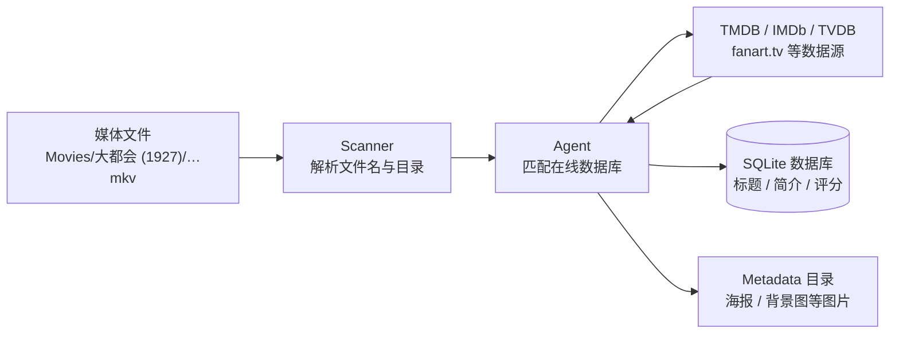
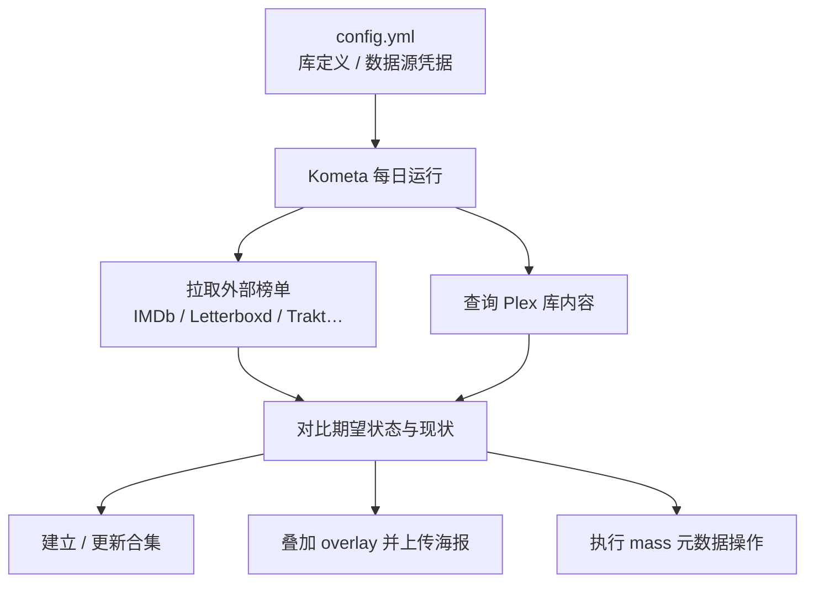

## Plex 元数据的工作原理

一个视频文件从进入媒体目录，到以完整的海报、简介、演员表出现在首页，中间要经过三个阶段：



1. **扫描（Scan）**：扫描器（Scanner）只解析路径和文件名，从中提取标题、年份这些线索；它不联网，也不读取文件内容，产出只是一条候选信息，比如这个路径下可能是 1927 年的电影 Metropolis。因此文件名是 `Metropolis (1927).mkv` 还是 `mtrpls.1080p.x264.mkv`，对后续每一步的成功率影响都很大。
2. **匹配（Match）**：代理（Agent）拿扫描得到的线索去在线数据库中搜索、打分，选定最可能的条目。目前新建电影库默认使用内建的 Plex Movie agent，数据聚合自 TMDB、IMDb、TVDB 等，海报和 logo 还会来自 fanart.tv 这类社区图库；老一代的插件式 agent（Plex Movie Legacy、The Movie Database 等）仍然可用，但官方已不再推荐。
3. **刮削（Scrape）**：把选定条目的完整元数据拉取到本地，包括标题、简介、评分等文字信息，以及海报、背景图等图片资产。

匹配结果记录为一个 `guid`，这是条目与外部数据库之间的锚点。两代 agent 的 guid 格式不同，写脚本时两种都要兼容：

```text
# Legacy agents expose the data source and external id directly
com.plexapp.agents.imdb://tt0017136?lang=en
com.plexapp.agents.themoviedb://19?lang=en

# The new agent uses Plex's own id; external ids live in child fields
plex://movie/5d7768254de0ee001fcc8f52
  ├── imdb://tt0017136
  ├── tmdb://19
  └── tvdb://…
```

与 `guid` 相对的是 `ratingKey`，即条目在这台服务器数据库中的自增主键。两者的区别在于可移植性：`ratingKey` 换一台服务器就变了，`guid` 指向的外部条目则不会变。用 API 操作单台服务器时，用 `ratingKey` 定位最快；要做跨服务器的配置或备份，就得存 `guid`。

刮削回来的数据存放在两个地方，都在 Plex 的数据目录下（Docker 部署通常挂载为 `/config`）：

- 文字类元数据（标题、简介、评分、演员表）存入 SQLite 数据库 `Plug-in Support/Databases/com.plexapp.plugins.library.db` 的 `metadata_items` 等表中；
- 图片类资产（海报、背景图、logo）存入 `Metadata/` 目录下按 hash 组织的 bundle。

知道存储位置有助于理解机制和排查问题，但不要绕过 Plex 直接修改数据库：表结构没有公开文档，一次不兼容的写入就可能损坏整个库。

## 手工修补与字段锁定

匹配和刮削不会每次都完美，总有需要手工干预的时候。在网页端打开条目的「编辑」界面，改标题、改简介、换海报，保存后字段旁会出现一个橙色的锁形图标。这个锁是 Plex 元数据管理中最关键的机制：**锁定的字段在下次刷新元数据时不会被 agent 覆盖**。手动编辑会自动锁定字段；也可以只点锁不改值，把 agent 当前刮削到的值固定下来。反过来，如果发现某个字段一直不随刷新更新，可以先检查它是否曾经被锁定。

如果错的是匹配本身，就用「修正匹配」（Fix Match）重新搜索，或者直接填入 TMDB/IMDb 链接。更换匹配后 guid 随之改变，所有未锁定的字段都会重新刮削。

## 用 plexapi 批量修补

界面操作适合零星几部，数量多了就该写脚本。[python-plexapi](https://python-plexapi.readthedocs.io/) 是 Plex API 最成熟的 Python 封装，网页端能做的操作基本都支持。连接只需要地址和 token，获取 token 最快的方式是在网页端任意条目上点「获取信息」再点「查看 XML」，地址栏里的 `X-Plex-Token` 参数就是 token：

```python
from plexapi.server import PlexServer

plex = PlexServer("http://127.0.0.1:32400", "YOUR_PLEX_TOKEN")
movies = plex.library.section("电影")
```

### 找出缺图的条目

条目的 `thumb` 属性对应海报，`art` 对应背景图，为空就是灰色占位图的来源。遍历大库时把 `container_size` 调大，能明显减少 API 往返：

```python
for movie in movies.all(container_size=500):
    missing = []
    if not movie.thumb:
        missing.append("poster")
    if not movie.art:
        missing.append("art")
    if missing:
        print(movie.ratingKey, movie.title, movie.year, missing)
```

老电影和版权状态存疑的影片最容易出现这种情况：agent 匹配到了正确的条目，但数据源本身就没有收录像样的图片。这种情况下反复刷新没有意义，只能自己找图补上。

### 从 TMDB 补齐海报

TMDB 的 `/movie/{id}/images` 接口在不带 `language` 参数时，会返回该条目在所有语言下的全部图片。先从 guid 里解析出 TMDB id，两代 agent 的格式都要兼容：

```python
import re

_TMDB = re.compile(r"(?:themoviedb|tmdb)://(\d+)")

def tmdb_id(movie) -> int | None:
    guids = [movie.guid, *(g.id for g in movie.guids)]
    for g in guids:
        if m := _TMDB.search(g or ""):
            return int(m.group(1))
    return None
```

TMDB 给每张图都标注了语言（`iso_639_1`，为空表示无文字版本）和票数。实践下来比较合理的排序策略是：

- 海报优先英文版本，其次无文字版本，因为无字海报常常只是剧照；
- 背景图相反，优先无文字版本，它作为详情页的底图，越干净越好；
- 同语言组内再按票数和分辨率排序。

拿到图片 URL 后上传。`uploadPoster` 支持 `url=` 和 `filepath=` 两种参数：传 URL 意味着让 Plex 服务器自己去下载图片，如果服务器所在的网络访问不了 `image.tmdb.org`，上传就会失败；先在运行脚本的机器上把图片下载下来，再以文件形式推送给 Plex，就能绕开服务器侧的网络限制：

```python
import os
import tempfile

import requests

def set_poster(movie, url: str) -> None:
    resp = requests.get(url, timeout=30)
    resp.raise_for_status()
    fd, path = tempfile.mkstemp(suffix=".jpg")
    with os.fdopen(fd, "wb") as fh:
        fh.write(resp.content)
    try:
        movie.uploadPoster(filepath=path)
    finally:
        os.remove(path)
```

上传的图片会成为当前选中的海报，存入服务器的 Metadata bundle，不会在媒体目录里生成 `poster.jpg` 文件。

### 中文库不显示 logo

logo（clear logo）是详情页和部分客户端界面上代替标题文字的透明底图形。中文库的常见现象是：绝大多数条目不显示 logo，少数显示的又是 agent 自动选择的中文 logo，质量参差不齐。原因在于 Plex 对 logo 的语言策略与海报不同：logo 被当作图形化的标题处理，只采用与库的元数据语言一致的版本，不会像海报那样回退到英文。这一点官方文档没有明确说明，但中文库的实际表现和社区讨论都指向这个行为。于是 TMDB 上没有中文 logo 的电影就干脆不显示 logo，尽管编辑界面的候选列表里就有现成的英文版本。

既然候选列表里有图，那就用脚本批量把它选上。较新版本的 plexapi 提供了 `logos()` 和 `setLogo()`：

```python
for movie in movies.all(container_size=500):
    if movie.isLocked("clearLogo"):
        continue  # skip manually locked logos
    logos = movie.logos()
    candidates = [
        lg for lg in logos
        if not lg.selected and not str(lg.ratingKey).startswith("metadata://")
    ]
    if not candidates:
        continue
    # Prefer fanart.tv logos, usually higher quality than TMDB ones
    pick = next(
        (lg for lg in candidates if lg.provider == "fanarttv"), candidates[0]
    )
    movie.setLogo(pick)
```

`setLogo` 调用的是和网页端手动点选相同的接口，选中后 PMS 会自动锁定 `clearLogo` 字段，之后刷新元数据不会被清掉。候选列表中以 `metadata://` 开头的条目是当前选中项的去重表示，跳过它才能保证换到另一张图。

### 批量统一中文标题

库里混着英文标题，想统一改成中文，几种直接的思路都不太可行：

- 刮削豆瓣：反爬严格，不适合批量稳定运行；
- 用 TMDB 的 `zh-CN` 翻译：覆盖不全，还常混着港台译名；
- 机器翻译：片名多为意译，机翻结果往往对不上通行译名。

比较可控的做法是维护一份本地对照表，人工或半自动填好中文名，再批量写回并锁定：

```python
overrides = {
    "12345": "大都会",  # ratingKey -> Chinese title
    "23456": "卡里加里博士的小屋",
}

for rating_key, zh_title in overrides.items():
    item = plex.fetchItem(int(rating_key))
    item.edit(**{"title.value": zh_title, "title.locked": 1})
```

`title.locked: 1` 等同于在界面上锁住标题字段；少了它，下次刷新元数据时标题又会变回去。

### 批量写操作的安全习惯

这类脚本都在直接修改服务器状态，上传和编辑都没有撤销操作，有几个习惯值得保持：

1. 给脚本留一个 `--dry-run` 模式，先打印执行计划，确认后再实际运行；
2. 正式运行前，先拿一两个 `ratingKey` 小批量验证效果，确认无误再处理整个库；
3. 确认 PMS 的数据库定期备份处于开启状态（默认开启，见设置里的计划任务），元数据出了问题，它是最后的恢复手段。

## Kometa：把元数据管理写成配置文件

上面的脚本解决的是一次性修补，还有一类需求是持续性的：IMDb Top 250 榜单变了，合集要跟着变；新入库的 4K 电影，海报上要自动加标；评分想统一换成 IMDb 的分数。这类需要定期对齐的工作，适合交给 [Kometa](https://kometa.wiki)。

Kometa 的前身是 Plex Meta Manager（PMM），2024 年 4 月随 v2.0 改名。它是一个 Python 批处理工具，读取 YAML 配置，连接 Plex 以及 TMDB、IMDb、Trakt、Letterboxd、MDBList 等外部数据源，主要做三类事情：

- 按各种来源建立合集（collection）；
- 给海报叠加覆盖层（overlay）；
- 批量执行元数据操作（operation）。

它不是常驻服务，每轮运行结束后即退出，等待下一个调度时刻。



Docker 部署时用 `KOMETA_TIMES` 指定每天的运行时刻，`KOMETA_RUN=False` 避免容器重启时额外触发一轮运行：

```yaml title="docker-compose.yml"
services:
  kometa:
    image: kometateam/kometa:latest
    container_name: kometa
    environment:
      - TZ=Asia/Shanghai
      - KOMETA_TIMES=08:30
      - KOMETA_RUN=False
    volumes:
      - /srv/kometa/config:/config
    restart: unless-stopped
```

配置的入口是 `config/config.yml`，`libraries` 下的键必须和 Plex 里的库名完全一致，底部放 Plex 和各数据源的凭据：

```yaml title="config.yml"
libraries:
  电影:
    collection_files:
      - default: imdb
    remove_overlays: false
    overlay_files:
      - default: resolution
plex:
  url: http://172.17.0.1:32400
  token: YOUR_PLEX_TOKEN
tmdb:
  apikey: YOUR_TMDB_V3_KEY
```

这份文件里带着 Plex token 和各家 API key，如果基础设施配置进了 Git，记得把它排除在外，仓库里只留脱敏的样板。

### 合集：从官方 defaults 到自定义 builder

`- default: imdb` 引用的是 Kometa 内置的 [Defaults 文件](https://kometa.wiki/en/latest/defaults/guide/)，官方维护了几十个开箱即用的合集方案，覆盖各大榜单、奖项、流派、国家、电影宇宙等。每个 defaults 文件都暴露一组 `template_variables` 供定制，比如只要 IMDb Top 250、不要热门榜和低分榜：

```yaml
libraries:
  电影:
    collection_files:
      - default: imdb
        template_variables:
          use_all: false
          use_top: true  # keep only the IMDb Top 250 collection
          use_separator: false  # do not create separator collections
      - default: country
        template_variables:
          style: color  # color flag poster style
          sort_by: random
          minimum_items: 10  # skip countries with fewer than 10 movies
```

defaults 覆盖不到的需求就自己写合集文件。合集的核心概念是 builder，即用什么规则筛选电影。builder 分两类，行为差别很大：

- `plex_search`、`smart_filter` 这类基于库内条件的 builder，建的是 Plex 原生的智能合集，新入库的影片自动加入或移出，即使 Kometa 不运行也能保持最新；
- `imdb_chart`、`letterboxd_list`、`trakt_list` 这类基于外部榜单的 builder，建的是普通合集，成员由每次运行时的榜单快照决定，Kometa 不运行就不会更新。

```yaml title="config/my-collections.yml"
collections:
  九十年代华语佳片:
    plex_search:  # smart collection: auto-maintained by Plex
      all:
        country: China
        year.gte: 1990
        year.lte: 1999
        critic_rating.gte: 8
  戛纳金棕榈:
    imdb_award:  # regular collection: synced on each Kometa run
      event_id: ev0000147  # Cannes Film Festival
      event_year: all
      award_filter: Palme d'Or
      winning: true
    sync_mode: sync  # remove items no longer on the list
    collection_order: custom
```

在 `config.yml` 里用 `- file: config/my-collections.yml` 引用即可。

### Overlay：给海报叠加信息层

overlay 是 Kometa 最具代表性的功能：在海报角落自动加上分辨率、音频编码、评分、获奖标识这类小徽章。它的机制值得了解，因为它会直接改写 Plex 里的海报。每次运行时：

1. 计算哪些条目应该有哪些 overlay；
2. 取干净的原图，叠加图层，把成品上传给 Plex；
3. 备份原图，并给条目打上 `Overlay` 标签用于追踪。

下次运行时，如果某个条目不再命中任何 overlay 规则，就用备份把原图还原回去。

```yaml
libraries:
  电影:
    remove_overlays: false  # set true to remove all overlays and restore originals
    overlay_files:
      - default: resolution  # 4K / 1080P badges
      - default: ratings
        template_variables:
          rating1: critic
          rating1_image: imdb
```

所以**叠加过 overlay 的条目，不要再在 Plex 界面里手动换海报**。Kometa 依靠标签和备份来追踪状态，手动一换，它可能把带徽章的图当成原图，下一轮就会在徽章上再叠一层徽章。想换图，正确的入口是 Kometa 的 assets 目录，或者先移除该条目的 `Overlay` 标签再换。

### Operations：批量元数据操作

operations 作用于整个库，适合统一各字段的数据来源。比如 Plex 自带的评分来源比较杂，想让详情页的评分一律显示 IMDb 分、流派标签一律跟随 TMDB：

```yaml
libraries:
  电影:
    operations:
      mass_critic_rating_update: imdb
      mass_genre_update: tmdb
```

`mass_*_update` 系列覆盖了评分、流派、分级、上映日期、工作室等几乎所有字段，取值就是数据源名称。这类操作会直接修改库里每一个条目，第一次运行前想清楚，或者先在小库上试验。

### 调度与运行经验

用了一段时间后总结出几条经验，都和 Kometa 的批处理特性有关。

运行时刻要避开 Plex 自己的维护窗口。PMS 每天有一段计划任务时间（设置里的「计划任务」，默认在凌晨），数据库优化、深度媒体分析等任务都集中在这个时段执行，如果 Kometa 同时运行，两者竞争数据库资源，运行时间会成倍增长。把 `KOMETA_TIMES` 错开到维护窗口之后，差别很明显。

大型榜单也没有必要每天重建。IMDb Top 250、Letterboxd Top 500 这类榜单一个月也变动不了几部，但每次全量重建都要对 TMDB 和 Plex 发起持续几十分钟的请求。可以给这类合集文件单独设置低频调度，比如每月 1 号和 15 号各运行一次，其余日子跳过。`delete_not_scheduled` 默认为 false，不在调度中的文件只会被跳过，已建好的合集不会被删除：

```yaml
libraries:
  电影:
    collection_files:
      - default: country  # library-based, runs daily
      - default: imdb
        template_variables:
          schedule: monthly(1), monthly(15)
          use_all: false
          use_top: true
```

另外，Kometa 每次运行会把未显式配置的默认值写回 `config.yml`，线上那份配置会越来越长，自己维护的源文件保持最小化即可。我的完整配置（脱敏样板）放在 [homelab-infra](https://github.com/synthpop123/homelab-infra) 仓库的 plex stack 里，配合 Komodo 做 GitOps 部署，相关背景见[上一篇文章](/blog/komodo-gitops)。

## 小结

Plex 元数据的问题，按性质分派给不同的工具处理：

- 零星几部的错配、改名、换图：网页端的编辑和修正匹配就够了，留意字段锁定的语义；
- 入库质量：文件命名决定匹配成功率，交给 Radarr、Sonarr 这类自动化改名工具最省心；
- 一次性的批量修补，比如缺图、logo、标题统一：写 plexapi 脚本，dry-run 先行；
- 持续性的合集维护、海报徽章、字段来源统一：交给 Kometa 按天调度；
- 直接打开 SQLite 改库：任何时候都不在选项里。

## 参考链接

- [Metadata Agents（Plex 官方）](https://support.plex.tv/articles/200241558-agents/)，agent 与数据源优先级
- [Where is the Plex Metadata Stored?（Plexopedia）](https://www.plexopedia.com/plex-media-server/general/metadata-stored/)，SQLite 数据库与 Metadata 目录
- [python-plexapi 文档](https://python-plexapi.readthedocs.io/)，Plex API 的 Python 封装
- [TMDB API 文档](https://developer.themoviedb.org/docs/getting-started)，图片接口与语言字段
- [Kometa Wiki](https://kometa.wiki/)，安装、配置与 defaults 总览
- [Kometa Defaults Usage Guide](https://kometa.wiki/en/latest/defaults/guide/)，内置合集与 template_variables
- [Kometa Overlays Guide](https://kometa.wiki/en/latest/kometa/guides/overlays/)，overlay 的工作机制与注意事项
