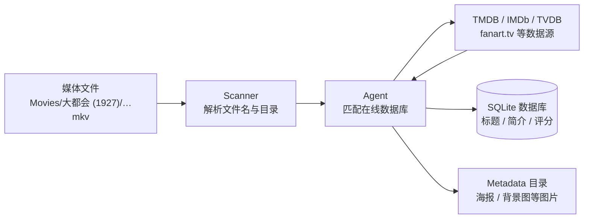
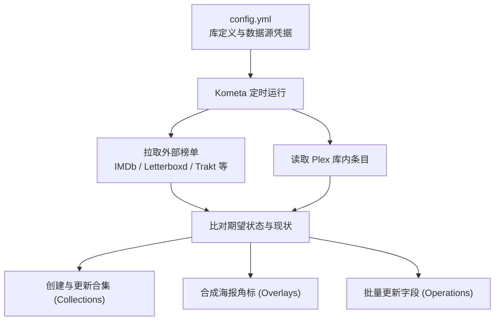

## Plex 元数据的工作原理

一个视频文件从放进媒体库目录，到在客户端展示出完整的海报、演员表和简介，Plex 内部会依次执行扫描、匹配和刮削三个步骤：



1. **扫描（Scan）**：扫描器（Scanner）只解析本地文件路径和文件名，从中提取片名、年份等文字线索。这一步不联网，也不读取视频流内容，产出的只是一条候选信息。因此文件名是规范的 `Metropolis (1927).mkv` 还是压制组原名 `mtrpls.1080p.x264.mkv`，会直接决定后续匹配的准确率。
2. **匹配（Match）**：代理（Agent）拿扫描提取到的线索去在线数据库检索打分，选定最匹配的条目。目前新建电影库默认使用内置的 **Plex Movie** 代理，数据整合自 TMDB、IMDb、TVDB，海报和 Logo 还会引入 fanart.tv 等社区图库；早期的插件式代理（如 Plex Movie Legacy、The Movie Database）仍可使用，但官方已不再维护。
3. **刮削（Scrape）**：匹配命中后，Plex 将对应条目的标题、简介、演职员表等文字信息，以及海报、背景图等图片下载到本地。

### guid 与 ratingKey

匹配完成后，Plex 会通过两个标识符来定位条目。

`guid` 是指向外部数据源的全局标识，用来记录条目对应哪部作品。新旧两代代理生成的 `guid` 格式不同，编写脚本时需要同时兼容：

```text
# 旧版插件式代理直接暴露数据源与外部 ID
com.plexapp.agents.imdb://tt0017136?lang=en
com.plexapp.agents.themoviedb://19?lang=en

# 新版 Plex Movie 代理使用自建 ID，外部 ID 存放在子字段 guids 中
plex://movie/5d7768254de0ee001fcc8f52
  ├── imdb://tt0017136
  ├── tmdb://19
  └── tvdb://…
```

`ratingKey` 则是当前这台 Plex 服务器数据库中的自增主键（纯数字）。两者的作用范围不同：`ratingKey` 只在当前服务器内有效，重建服务器后就会改变，适合在针对单台服务器的 API 脚本里快速索引；`guid` 绑定的是外部固定的影片条目，跨机器迁移配置或比对片单时应以 `guid` 为准。

### 本地存储位置

刮削到本地的数据都存放在 Plex 的数据目录下（Docker 部署通常挂载为 `/config`）：

- **文字类元数据**：标题、简介、评分、演员表等存入 SQLite 数据库 `Plug-in Support/Databases/com.plexapp.plugins.library.db` 的 `metadata_items` 等表中。
- **图片类资产**：海报、背景图、Logo 等存入 `Metadata/` 目录下按哈希组织的 bundle 子目录中。

了解这些位置有助于排查路径和权限问题，但不要绕过 Plex 直接用 SQL 修改数据库。Plex 的表结构没有公开文档，直接写入会绕过应用层的校验与索引维护，很容易损坏数据库。

## 手工修补与字段锁定

遇到个别影片刮削出错，直接在 Web 端修改最快。打开条目的「编辑」窗口，修改标题、简介或更换海报并保存后，对应字段旁会亮起一个**橙色锁图标**。这个图标表示该字段已被锁定，**后续刷新元数据时不会被代理重新覆盖**。除了编辑后自动加锁，也可以直接点击锁图标，把代理当前刮削到的值固定下来。反过来，如果发现某部电影刷新元数据后依然停留在旧标题，可以先点进编辑页检查对应字段是不是之前被锁住了。

如果是影片本身认错了，则需要点击条目菜单里的「修正匹配」（Fix Match），手动搜索片名或直接输入 TMDB、IMDb 编号。更换匹配后条目的 `guid` 会随之改变，所有未锁定的字段都会重新拉取。

## 用 plexapi 批量修补

网页操作只适合处理零星几部影片，成百上千部条目的批量清理还是需要脚本。[python-plexapi](https://python-plexapi.readthedocs.io/) 是目前最成熟的 Plex API Python 封装，Web 端能做的操作基本都可以通过它完成。

连接服务器需要地址和 Token。获取 Token 最简单的方式是在 Web 端任意影片上点击「获取信息 › 查看 XML」，浏览器打开的新标签页地址栏末尾的 `X-Plex-Token` 参数就是：

```python
from plexapi.server import PlexServer

plex = PlexServer("http://127.0.0.1:32400", "YOUR_PLEX_TOKEN")
movies = plex.library.section("电影")
```

### 找出缺图的条目

影片对象的 `thumb` 属性对应海报，`art` 对应背景图，属性为空时客户端就会显示灰色占位图。遍历大库时把 `container_size` 调大，可以减少分页请求的往返次数：

```python
for movie in movies.all(container_size=500):
    missing = []
    if not movie.thumb:
        missing.append("poster")
    if not movie.art:
        missing.append("art")
    if missing:
        print(f"[{movie.ratingKey}] {movie.title} ({movie.year}) 缺失: {missing}")
```

老电影和小众冷门片最容易遇到这种情况：代理匹配到了正确的条目，但在线数据源本身没有收录对应语言的图片。这时反复刷新元数据没有用，需要从外部接口补图。

### 从 TMDB 补齐海报

调用 TMDB 的 `/movie/{id}/images` 接口且不传 `language` 参数时，接口会返回该影片在所有语言下的全部图片。第一步是从影片的 `guid` 和子字段 `guids` 中提取出 TMDB ID：

```python
import re

_TMDB = re.compile(r"(?:themoviedb|tmdb)://(\d+)")

def get_tmdb_id(movie) -> int | None:
    guids = [movie.guid, *(g.id for g in movie.guids)]
    for g in guids:
        if m := _TMDB.search(g or ""):
            return int(m.group(1))
    return None
```

TMDB 会为每张图片标注语言（`iso_639_1`，为空代表无文字纯图）和评分票数。实际筛选时可以按以下优先级排序：

- 海报优先选英文版，其次选无文字版（无文字海报里常混有普通剧照）；
- 背景图作为详情页底图，优先选无文字版；
- 同一语言组内再按票数和分辨率高低排序。

选好图片 URL 后通过 `uploadPoster` 写入 Plex。需要注意 `uploadPoster` 支持 `url` 和 `filepath` 两种参数：传 `url` 时是由 Plex 服务端发起请求去下载图片，如果 Plex 所在主机无法顺畅访问 `image.tmdb.org`，上传就会超时失败。更稳妥的做法是在运行脚本的机器上先把图片下载到临时文件，再通过本地路径推送给 Plex：

```python
import os
import tempfile
import requests

def upload_poster_from_url(movie, image_url: str) -> None:
    resp = requests.get(image_url, timeout=30)
    resp.raise_for_status()

    fd, tmp_path = tempfile.mkstemp(suffix=".jpg")
    try:
        with os.fdopen(fd, "wb") as f:
            f.write(resp.content)
        movie.uploadPoster(filepath=tmp_path)
    finally:
        if os.path.exists(tmp_path):
            os.remove(tmp_path)
```

上传后的图片会存入服务器的 `Metadata/` 目录并设为当前海报，不会污染原本存放视频的媒体文件夹。

### 解决中文库不显示 Clear Logo 的问题

Clear Logo 是详情页和部分第三方客户端用来代替文字标题的透明底艺术字。中文媒体库经常遇到一个现象：绝大多数电影不显示 Logo，少数显示出来的中文 Logo 质量也参差不齐。

这是因为 Plex 对 Logo 的语言回退策略和海报不同。海报在没有中文版时会自动回退到英文原版，而 Logo 被当作图形化的标题处理，默认只采用与媒体库语言一致的版本。如果 TMDB 上没有中文 Logo，Plex 就会直接留空，哪怕编辑界面的候选列表里已经有许多高质量的英文 Logo。

既然候选列表里已经有拉取下来的英文 Logo，就可以用 `plexapi` 的 `logos()` 和 `setLogo()` 批量激活：

```python
for movie in movies.all(container_size=500):
    if movie.isLocked("clearLogo"):
        continue  # 跳过已手动锁定的条目

    logos = movie.logos()
    # 过滤掉当前选中项（以 metadata:// 开头）
    candidates = [
        lg for lg in logos
        if not lg.selected and not str(lg.ratingKey).startswith("metadata://")
    ]
    if not candidates:
        continue

    # 优先选择 fanart.tv 来源，抠图质量通常高于 TMDB
    pick = next((lg for lg in candidates if lg.provider == "fanarttv"), candidates[0])
    movie.setLogo(pick)
```

候选列表中以 `metadata://` 开头的条目是当前已选中图片在本地的映射，跳过它才能确保切换到新图。调用 `setLogo` 后，Plex 会自动锁定 `clearLogo` 字段，后续刷新元数据时不会被清空。

### 批量统一中文标题

如果媒体库里混有英文标题或港台译名，想批量改成简体中文通行译名，直接靠外部接口自动化往往不太理想：豆瓣反爬严格，不适合批量请求；TMDB 的 `zh-CN` 字段覆盖不全且常混入地区译名；机器翻译又无法处理意译片名。

更可控的做法是在本地维护一份对照表，人工核对好译名后按 `ratingKey` 批量写入并加锁：

```python
title_overrides = {
    "1024": "大都会",
    "1025": "卡里加里博士的小屋",
}

for rating_key, zh_title in title_overrides.items():
    item = plex.fetchItem(int(rating_key))
    item.edit(**{
        "title.value": zh_title,
        "title.locked": 1,  # 锁定字段，防止刷新元数据时还原
    })
```

这类批量写操作会直接改动服务端状态且无法一键撤销。建议给脚本加上 `--dry-run` 选项先核对输出，正式执行前先挑一两个 `ratingKey` 验证效果，并确认 Plex 设置里的「计划任务 › 备份数据库」处于开启状态。

## 用 Kometa 自动化维护

一次性脚本适合清理存量问题，但日常运营媒体库还有很多持续性的需求：IMDb Top 250 榜单变化后合集要跟着更新、新入库的 4K 电影要在海报角上自动加徽章、全库评分想统一成 IMDb 分数。这类定期对齐的工作适合交给 [Kometa](https://kometa.wiki)（原名 Plex Meta Manager，2024 年发布 v2.0 时更名）。

Kometa 是一个基于 YAML 配置的 Python 批处理工具，连接 Plex 与 TMDB、IMDb、Trakt、Letterboxd 等外部数据源，定时完成合集维护（Collections）、海报图层叠加（Overlays）和字段批量更新（Operations）。



### Docker 部署与基础配置

Kometa 不是常驻后台服务，每轮运行结束后就会等待下一个调度周期。Docker 部署时通过 `KOMETA_TIMES` 指定每天的运行时间，并将 `KOMETA_RUN` 设为 `False`，避免容器重启时立刻触发一轮全量扫描：

```yaml title="docker-compose.yml"
services:
  kometa:
    image: kometateam/kometa:latest
    container_name: kometa
    environment:
      - TZ=Asia/Shanghai
      - KOMETA_TIMES=08:30
      - KOMETA_RUN=False
    volumes:
      - /srv/kometa/config:/config
    restart: unless-stopped
```

入口配置文件为 `config/config.yml`，其中 `libraries` 下的键名必须与 Plex 中的媒体库名称一致，底部配置 Plex 和各数据源的凭据：

```yaml title="config.yml"
libraries:
  电影:
    collection_files:
      - default: imdb
    remove_overlays: false
    overlay_files:
      - default: resolution
plex:
  url: http://172.17.0.1:32400
  token: YOUR_PLEX_TOKEN
tmdb:
  apikey: YOUR_TMDB_API_KEY
```

因为 `config.yml` 中包含 Token 和 API Key，而且 Kometa 每次运行后都会把未显式声明的默认参数自动补写进这份文件，如果用 Git 管理配置，建议将运行时的 `config.yml` 排除在外，仓库里只保留脱敏后的最小配置模板。

### 合集：内置预设与自定义规则

配置中的 `- default: imdb` 引用的是 Kometa 官方维护的 [Defaults 预设](https://kometa.wiki/en/latest/defaults/guide/)，涵盖了常见榜单、奖项、流派、国家和系列电影。每个预设都提供了一组 `template_variables` 用于按需裁剪，比如只生成 IMDb Top 250 合集、不生成分隔条目，并按国家生成彩色国旗封面的合集：

```yaml
libraries:
  电影:
    collection_files:
      - default: imdb
        template_variables:
          use_all: false
          use_top: true          # 只保留 IMDb Top 250
          use_separator: false   # 不创建分类分隔合集
      - default: country
        template_variables:
          style: color
          sort_by: random
          minimum_items: 10      # 影片少于 10 部的国家不建合集
```

预设覆盖不到的场景可以编写自定义合集文件（在 `config.yml` 中通过 `- file: config/my-collections.yml` 引入）。自定义合集通过 builder 定义筛选规则，两类 builder 的底层机制不同：

- **基于库内条件的智能合集（Smart Collection）**：如 `plex_search`、`smart_filter`。Kometa 只负责在 Plex 中创建一条筛选规则，后续新入库的影片只要满足条件就会由 Plex 自动归入合集，不依赖 Kometa 再次运行。
- **基于外部榜单的普通合集（Regular Collection）**：如 `imdb_chart`、`imdb_award`、`letterboxd_list`。这类合集由 Kometa 在每次运行时拉取外部列表并同步成员，Kometa 不运行合集内容就不会变化。

```yaml title="config/my-collections.yml"
collections:
  90年代华语高分电影:
    plex_search:
      all:
        country: China
        year.gte: 1990
        year.lte: 1999
        critic_rating.gte: 8

  戛纳金棕榈获奖影片:
    imdb_award:
      event_id: ev0000147
      event_year: all
      award_filter: Palme d'Or
      winning: true
    sync_mode: sync
    collection_order: custom
```

### Overlays：海报角标

Overlay 用于在海报角落自动叠加分辨率（4K / 1080P）、音频规格或评分徽章。Kometa 处理角标的流程是：先下载未加标的原始海报保存在本地备份目录，在本地合成角标图层后把成品海报上传回 Plex，同时给该条目打上 `Overlay` 标签以便追踪。下次运行时，如果某个条目不再命中任何角标规则，Kometa 会用本地备份把原图还原回去。

```yaml
libraries:
  电影:
    remove_overlays: false
    overlay_files:
      - default: resolution
      - default: ratings
        template_variables:
          rating1: critic
          rating1_image: imdb
```

使用这项功能有一条限制：**已经打上 Overlay 的影片，不要在 Plex Web 端手动更换海报**。手动换图后，条目上的 `Overlay` 标签仍在，Kometa 在下一轮运行时可能会把新上传的图片误判为已加标的图或覆盖原有备份，导致角标在原图上重复叠加变糊。如果需要换海报，应先移出条目的 `Overlay` 标签等 Kometa 还原后再换，或者直接将新海报放入 Kometa 的本地 assets 目录统一管理。

### Operations：批量统一字段来源

Plex 默认的评分和流派可能混杂多个来源。如果希望全库统一使用 IMDb 的评分和 TMDB 的流派分类，可以在库级别配置 `operations`：

```yaml
libraries:
  电影:
    operations:
      mass_critic_rating_update: imdb
      mass_genre_update: tmdb
```

`mass_*_update` 支持批量改写评分、流派、分级、发行日期等字段。由于它会遍历并修改库内的每一个条目，首次开启前建议先在测试小库上验证效果。

### 调度与运行经验

实际运行 Kometa 时，有两个调度细节很影响执行效率：

1. **错开 Plex 自身的后台维护时段**：Plex 每天会在「设置 › 计划任务」指定的时间窗口（默认在凌晨 2:00 至 5:00）执行数据库优化和音视频分析。如果 Kometa 同时运行，两者争抢 SQLite 数据库连接，耗时会翻几倍甚至报错超时。把 `KOMETA_TIMES` 放到清晨（如 `08:30`）能避开锁竞争。
2. **给大型静态榜单单独降频**：IMDb Top 250、奖项名单这类合集一个月也变动不了几部，但每次全量比对都要向 TMDB 和 Plex 发起十几分钟的请求。可以通过 `schedule` 将这类任务设为每月运行一两次。`delete_not_scheduled` 默认为 `false`，未到排期的日子里 Kometa 只会跳过更新，不会删掉已有合集：
   ```yaml
   libraries:
     电影:
       collection_files:
         - default: country
         - default: imdb
           template_variables:
             schedule: monthly(1), monthly(15)
             use_all: false
             use_top: true
   ```

我目前使用的完整脱敏配置存放在 [synthpop123/homelab-infra](https://github.com/synthpop123/homelab-infra) 仓库中，配合 Komodo 做自动部署，具体流程可以参考[通过 Komodo + Renovate 构建 Docker Compose GitOps 流水线](/blog/komodo-gitops)。

## 工具选型总结

| 场景 | 适用工具 | 注意事项 |
| :--- | :--- | :--- |
| **个别影片错配、改名或换海报** | Plex Web 端「修正匹配」与「编辑」 | 留意橙色锁图标的锁定状态 |
| **新片入库命名标准化** | Radarr / Sonarr 自动改名 | 规范的文件名与年份能避免绝大部分匹配失败 |
| **存量库批量修补（缺图、Logo、译名）** | `python-plexapi` 脚本 | 配合 `--dry-run`，图片先下载到本地再上传 |
| **周期性榜单同步、海报角标与评分统一** | Kometa | 错开 Plex 凌晨维护窗口，启用 Overlay 后不要在网页端手动换图 |
| **直接读写 SQLite 数据库** | 不建议 | 仅用于排查只读问题，直接写入容易损坏索引 |

## 参考链接

- [Metadata Agents（Plex 官方文档）](https://support.plex.tv/articles/200241558-agents/)，代理机制与数据源说明
- [Where is the Plex Metadata Stored?（Plexopedia）](https://www.plexopedia.com/plex-media-server/general/metadata-stored/)，SQLite 数据库与 Metadata 目录结构
- [python-plexapi 文档](https://python-plexapi.readthedocs.io/)，Plex API 的 Python 封装
- [TMDB 开发者 API 指南](https://developer.themoviedb.org/docs/getting-started)，图片接口与语言字段说明
- [Kometa 官方 Wiki](https://kometa.wiki/)，安装、配置与 Defaults 预设总览
- [Kometa Defaults Usage Guide](https://kometa.wiki/en/latest/defaults/guide/)，内置合集与 `template_variables` 参数
- [Kometa Overlays 使用指南](https://kometa.wiki/en/latest/kometa/guides/overlays/)，海报图层的工作机制与注意事项
