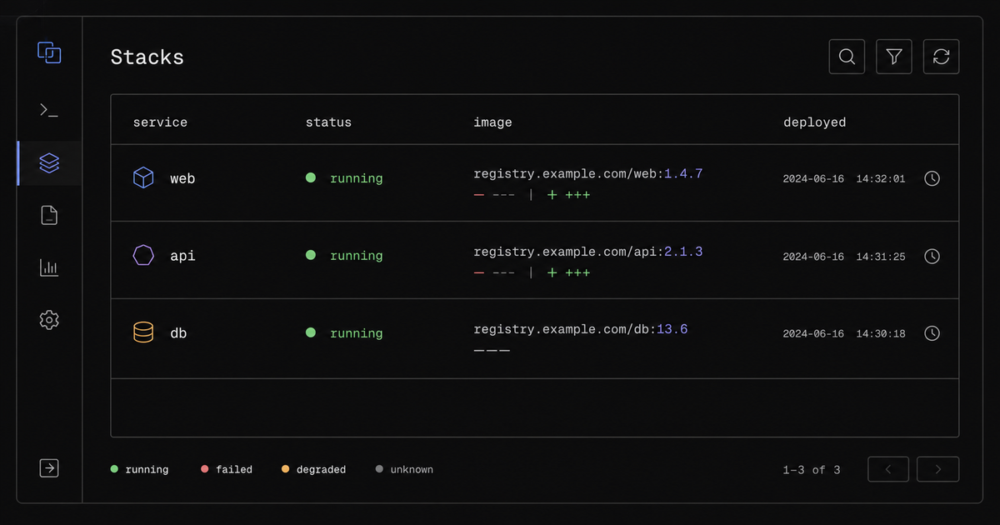
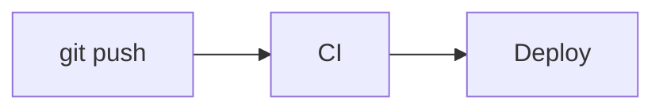

Every Markdown feature the posts use, and the edge cases each one has to survive, on one page. A change to the pipeline or the prose styles is checked here first, in light and dark, wide and on a phone.

## Headings with `code`, $x^2$ and a title long enough to wrap onto a second line at the reading measure

### A repeated heading

### A repeated heading

#### Fourth level

##### Fifth level, with `code` at the small size

###### Sixth level

## Inline

Plain text with **strong**, _emphasis_, ~~struck~~, `inline code`, `const x = 1{:ts}` highlighted inline, <kbd>Cmd</kbd> + <kbd>K</kbd>, and an aside (a parenthetical, dimmed) beside a call like f(x) that is not one. Links: [a post](/blog/push-based-k3s) with its preview, [an external site](https://github.com/synthpop123/homepage), [a bare page](https://example.com/some/path), and a [full-origin link](https://lkwplus.com/about) that becomes root-relative.

A long unbroken token: `supercalifragilistic-expialidocious-and-then-some-more-text-that-runs-past-the-column`, and a long URL https://example.com/a/very/long/path/that/keeps/going/and/going/past/the/measure.

Maths inline, $e^{i\pi} + 1 = 0$, and as a block:

$$
\sum_{k=1}^{n} k = \frac{n(n+1)}{2}, \qquad \mathbb{E}[X] = \int_{-\infty}^{\infty} x f(x)\,dx
$$

## 中文段落

<div lang="zh-CN">

中文正文与 English words、数字 2026 之间由浏览器自动留出间距，不手动加空格。强调用着重号：这是*重点*，不用斜体。括号里的话会弱化（像这样的旁白），半角括号 (half-width) 也一样。一段足够长的中文，用来检查行高、两端对齐与标点挤压：在 Push 模式下，需要明确规定每种配置用什么命令下发，仓库通过顶层目录来区分管理机制，而底层配置虽然也是 YAML 文件，却不能通过同一条命令下发。

</div>

## Callouts

:::note
A note with `code` and a [link](/about).
:::

:::tip[With a label]
A tip whose title carries its own label.
:::

:::warning
A warning.
:::

:::caution{closed}
A caution that starts closed.
:::

:::important
An important callout holding a list:

- one
- two
:::

## Lists

- An unordered item
  - nested once
    - nested twice
- Another item, long enough to wrap onto a second line so the hanging indent shows where the marker sits against the text.

1. An ordered item
2. Another
   1. nested ordered

- [x] A done task
- [ ] An open task

## Steps

:::steps
1. Install the tool:

   ```shell
   brew install mas
   ```

2. A step with only text, long enough to wrap onto a second line so the rail shows how it runs down beside the text to the next number.

3. The last step, with no rail after it.
:::

<div lang="zh-CN">

:::steps
1. 卸载旧版本，再配置软件源。
2. 安装最新版本并验证。
:::

</div>

## File tree

:::file-tree
- homelab-infra/
  - komodo/
    - **sync.toml** the central declaration
  - stacks/ one directory per stack
    - wallos/
      - compose.yaml
  - scripts/
    - validate.sh shared by local runs and CI, see `make lint`
  - renovate.json 自动升级规则
:::

## Code

```ts title="src/example.ts" {2} ins={4} del={5}
export function greet(name: string): string {
  const greeting = `Hello, ${name}` // marked
  return greeting
  // inserted
  // deleted
}
```

```bash
make node-config NODE=sg  # 渲染新加坡节点的 k3s 配置，经 SSH 写入并重启 k3s-agent，这条注释足够长会折行
```

```diff
- removed line
+ added line
  unchanged line
```

```yaml collapse={4-9}
services:
  app:
    image: example/app:1.0
    environment:
      - ONE=1
      - TWO=2
      - THREE=3
      - FOUR=4
      - FIVE=5
    restart: unless-stopped
```

```text
A plain text block with a line long enough to wrap: lorem ipsum dolor sit amet, consectetur adipiscing elit, sed do eiusmod tempor.
```

## Tables

| Column | With `code` | Right |
| :--- | :--- | ---: |
| `apps/<name>/` | `kubectl apply -k` | 1 |
| A cell long enough to wrap onto a second line inside its column | `helm upgrade --install` | 1,234 |

| A | wide | table | with | many | columns | that | scrolls | sideways |
| --- | --- | --- | --- | --- | --- | --- | --- | --- |
| one | two | three | four | five | six | seven | eight | nine |

## Quotes, rules and images

> A blockquote with **strong** text and a second sentence to wrap the line.

---



*A caption: an emphasised line right under an image, small, muted and centred*

<div lang="zh-CN">


*中文图注同样不带着重号，一整句话都在图片下方居中*

</div>

## Diagram


